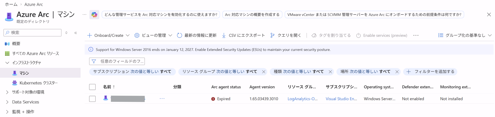
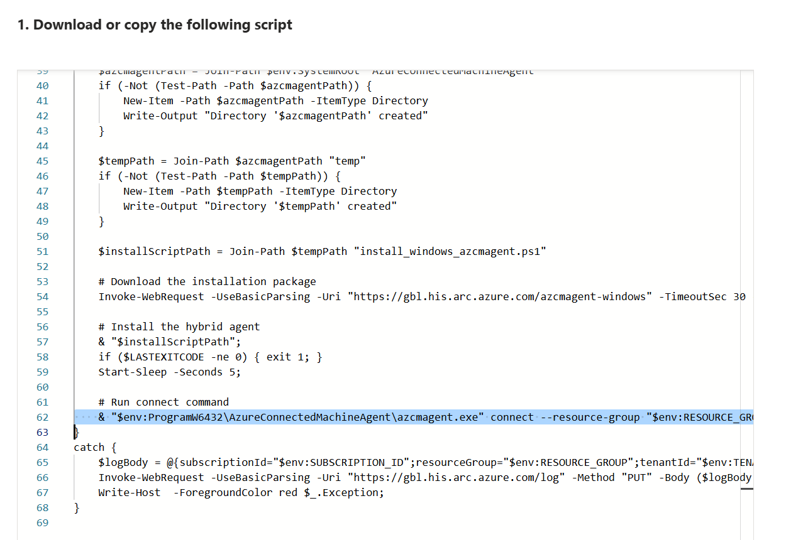

こんにちは、Azure Monitoring サポート チームの大間知、塚本です。

Azure Arc 対応サーバーが長期間 Azure と通信できない状態になると、エージェントの状態が **[期限切れ (Expired)]** になることがあります。
本記事では、期限切れになった Azure Arc 対応サーバーを切断し、再接続する手順をご案内します。

<!-- more -->

## 「期限切れ」になる理由

Azure Arc 対応サーバーでは、Azure Connected Machine エージェントが Azure との認証に使用するシステム割り当てマネージド ID の証明書を管理しています。

この証明書の有効期間は 90 日です。
エージェントは証明書の残りの有効期間が 45 日以下になると更新を試みますが、サーバーが Azure と通信できない場合は更新できません。
証明書を更新できないまま有効期限を迎えると、Azure ポータル上の状態が [期限切れ (Expired)] になります。



すでに期限切れになった場合は、エージェントを一度切断したうえで、オンボーディング資格情報を使用して再接続する必要があります。

## 事前確認

作業を始める前に、次の点をご確認ください。

- 対象サーバーで管理者権限を使用できること
- Azure Arc 対応サーバー リソースの削除および再作成に必要な Azure RBAC 権限があること

## 再接続手順

### 1. サーバーを Azure Arc から切断する

対象サーバー上で、`azcmagent disconnect` コマンドを実行し、サーバーを Azure Arc から切断します。

Windows では、管理者としてコマンド プロンプトまたは PowerShell を起動し、次のコマンドを実行します。
Linux では、root ユーザーで実行するか、コマンドの先頭に `sudo` を付けて実行してください。

```CMD
azcmagent disconnect
```

切断後は、Azure ポータル上で対象のリソース情報が消えていることをご確認ください。

> [!CAUTION]
> **Azure Local 上で動作する Azure Arc 対応 VM の場合は、必ず `--force-local-only` オプションを指定してください。**
>
> `azcmagent disconnect --force-local-only`
>
> `--force-local-only` を指定せずに切断すると、Azure local VM が Azure とオンプレミスの両方から削除される可能性があります。

### 2. サーバーを Azure Arc に再接続する

ここでは、`azcmagent connect` コマンドを使用した接続方法をご案内します。
初回オンボード時と同様の手順でも、Azure Arc へ再接続いただくことが可能です。

Windows では、管理者としてコマンド プロンプトまたは PowerShell を起動し、次のコマンドを実行します。
Linux では、root ユーザーで実行するか、コマンドの先頭に `sudo` を付けて実行してください。

```CMD
azcmagent connect `
  --resource-group "<RESOURCE_GROUP_NAME>" `
  --tenant-id "<TENANT_ID>" `
  --location "<AZURE_REGION>" `
  --subscription-id "<SUBSCRIPTION_ID>"
```

ご利用の環境に合わせて適宜パラメータをご変更ください。
なお、パラメータにつきましては、下記資料やオンボーディングスクリプトの値をご参照ください。

[azcmagent connect](https://learn.microsoft.com/ja-jp/azure/azure-arc/servers/azcmagent-connect)

##### オンボーディングスクリプトでのパラメータの確認方法

1. Azure ポータルにて、[Azure Arc -> インフラストラクチャー -> マシン -> Onboard/Create] を選択

2. ご利用の環境に合わせてオンボーディングスクリプトを生成

3. オンボーディングスクリプトの内容に合わせて `azcmagent connect` コマンドのパラメータを変更



なお、オンボーディングスクリプトを実行いただくことでも再接続が可能です。

## 再接続を確認する

対象サーバー上で次のコマンドを実行し、エージェントの状態と接続先情報を確認します。

```CMD
azcmagent show
```

一度サーバーを Azure Arc から切断した場合は、再接続後に VM 拡張機能の再構成が必要です。

## まとめ

本記事では、期限切れとなった Azure Arc 対応サーバーを切断し、再接続する手順をご案内しました。
最後までお読みいただきありがとうございました！
