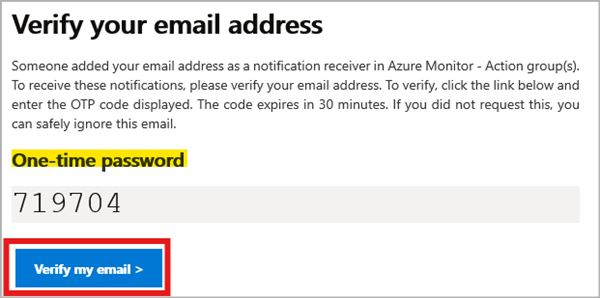
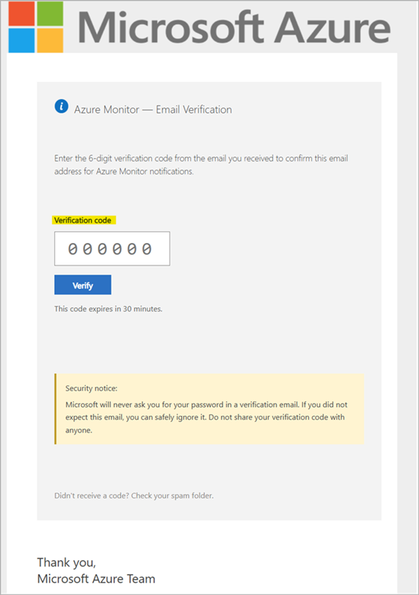
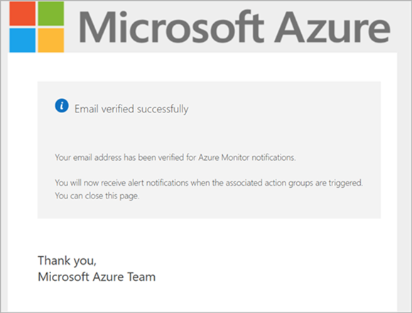
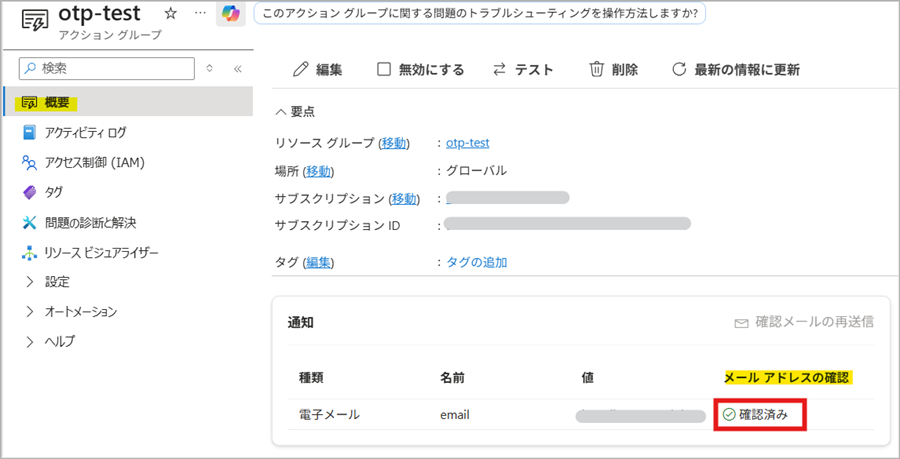
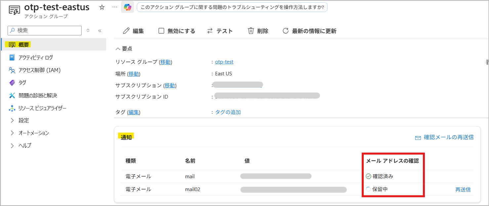
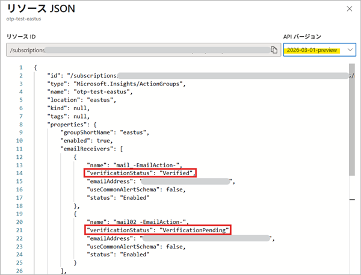
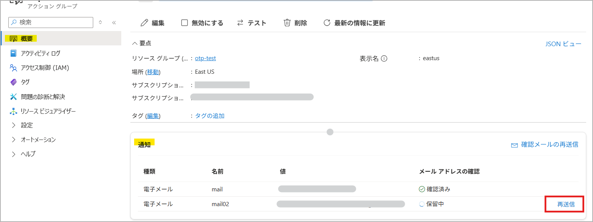
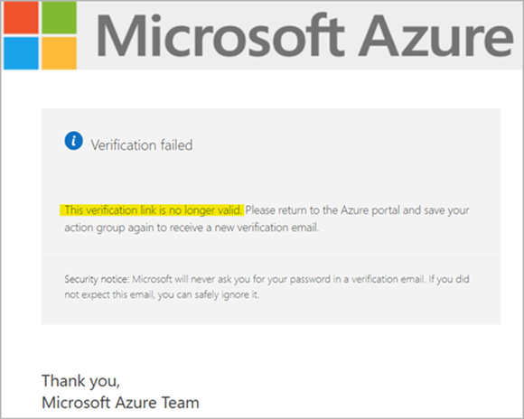

[更新履歴]
- 2026/10/16 : ブログ公開

こんにちは、Azure Monitoring サポート チームの北村です。
今回の記事では、サービス正常性にて通知された「Action recommended: Review new email verification requirement for Azure Monitor action groups」についてご紹介し、新しく追加するメール アドレスで必要となる OTP 認証の手順や認証状況の確認方法、よくあるご質問についてご説明します。

<br>

<!-- more -->
## 目次
- [1. 報告された正常性の勧告について](#1-報告された正常性の勧告について)
  - [1-1. 概要](#1-1-概要)
  - [1-2. 内容](#1-2-内容)
  - [1-3. 今後必要となるアクション](#1-3-今後必要となるアクション)
- [2. ワンタイム パスコード (OTP) で認証する手順](#2-ワンタイム-パスコード-OTP-で認証する手順)
  - [2-1. OTP 認証のメールを受け取る](#2-1-OTP-認証のメールを受け取る)
  - [2-2. OTP 認証を完了する](#2-2-OTP-認証を完了する)
  - [2-3. メール アドレスの認証状況を確認する](#2-3-メール-アドレスの認証状況を確認する)
  - [2-4. OTP 認証のメールを再送する](#2-4-OTP-認証のメールを再送する)
- [3. よくあるご質問](#3-よくあるご質問)
  - [Q1. OTP 認証を回避する方法はありますか。](#Q1-OTP-認証を回避する方法はありますか。)
  - [Q2. Microsoft Entra テナントで検証済みのドメインに属するメール アドレスであっても OTP 認証は必要ですか。](#Q2-Microsoft-Entra-テナントで検証済みのドメインに属するメール-アドレスであっても-OTP-認証は必要ですか。)
  - [Q3. OTP 認証の展開前から登録されていた既存のアクション グループのメール アドレスも認証の対象になりますか。](#Q3-OTP-認証の展開前から登録されていた既存のアクション-グループのメール-アドレスも認証の対象になりますか。)
  - [Q4. レガシ許可済み（LegacyAllowed）と確認済み（Verified）の違いは何ですか。](#Q4-レガシ許可済み（LegacyAllowed）と確認済み（Verified）の違いは何ですか。)
  - [Q5. あるアクション グループでは レガシ許可済み（LegacyAllowed）として表示されているメール アドレスを、別のアクション グループに追加すると保留中 (VerificationPending) と表示されるのはなぜですか。](#Q5-あるアクション-グループでは-レガシ許可済み（LegacyAllowed）として表示されているメール-アドレスを、別のアクション-グループに追加すると保留中-VerificationPending-と表示されるのはなぜですか。)
  - [Q6. メール アドレスの認証状況を確認する方法はありますか。](#Q6-メール-アドレスの認証状況を確認する方法はありますか。)
  - [Q7. OTP 認証に関するアクティビティ ログや診断ログ、監査記録は取得できますか。](#Q7-OTP-認証に関するアクティビティ-ログや診断ログ、監査記録は取得できますか。)
  - [Q8. ワンタイム パスコードを入力したら、有効期限が切れていると表示されました。この場合、どのように認証すればよいですか。](#Q8-ワンタイム-パスコードを入力したら、有効期限が切れていると表示されました。この場合、どのように認証すればよいですか。)
  - [Q9. 一度メール アドレスの認証を完了しました。同じテナント内の他のアクション グループでも再度認証が必要になりますか。](#Q9-一度メール-アドレスの認証を完了しました。同じテナント内の他のアクション-グループでも再度認証が必要になりますか。)
  - [Q10. OTP 認証のメールを受信できない場合、どのように対応すればよいですか。](#Q10-OTP-認証のメールを受信できない場合、どのように対応すればよいですか。)
  - [Q11. テスト通知を送信する場合も OTP 認証が必要ですか。](#Q11-テスト通知を送信する場合も-OTP-認証が必要ですか。)
  - [Q12. メール アドレスの受信者は、同じテナントのユーザーである必要がありますか。](#Q12-メール-アドレスの受信者は、同じテナントのユーザーである必要がありますか。)
  - [Q13. メーリング リストを登録した場合、すべての受信者で認証する必要がありますか。](#Q13-メーリング-リストを登録した場合、すべての受信者で認証する必要がありますか。)

<br>


## 1. 報告された正常性の勧告について
### 1-1. 概要

| 項目名 | 項目値 |
|-------------|--------------------------------------------------------------------------------------|
| 題名                 | Action recommended: Review new email verification requirement for Azure Monitor action groups |
| 追跡 ID              | CR_7-00Z |
| 影響を受けるサービス   | Azure Monitor |
| 影響を受けるリージョン | Central India, Central US EUAP, East US, East US 2, East US 2 EUAP, Germany West Central, Global, North Central US, South Central US, South India, Sweden Central, West US, West US 2 |
| 正常性イベントの種類   | 正常性の勧告 |

<br>

### 1-2. 内容
2026 年 10 月現在、すべてのリージョンで OTP 認証の適用が開始されています。以下は通知の原文と翻訳です。

You’re receiving this notification because you’re associated with one or more Azure subscriptions that currently use Azure Monitor action groups.

Starting as early as 17 July 2026, Azure Monitor action groups will begin a progressive regional rollout that requires one-time passcode (OTP) verification for new email addresses added to new or existing action groups before those email recipients can receive notifications.

No action is needed for email addresses that are already configured in existing action groups. These email addresses will continue to receive notifications as usual.

When you add a new email address to a new or existing action group, the email recipient must complete a one-time verification in the same tenant. An OTP email will be sent when the action group is saved, and the passcode will expire after 30 minutes. If the passcode expires, you can request another verification email from the action group page in the Azure portal.

Until verification is completed, the new email address won’t receive notifications from the action group.
As part of this change, you’ll also need to save and verify an email address before you can send test email notifications.

**翻訳**
このお知らせは、お客様が Azure Monitor のアクション グループを使用している 1 つ以上の Azure サブスクリプションに関連付けられているために送信されています。

2026 年 7 月 17 日以降、リージョンごとに順次展開される形で、新規または既存のアクション グループに追加された新しいメール アドレスについて、通知を受信できるようになる前にワンタイム パスコード (OTP) による認証が必要になります。

既存のアクション グループに既に設定されているメール アドレスについては、対応は不要です。これらのメール アドレスは、これまでどおり通知を受信できます。

新規または既存のアクション グループに新しいメール アドレスを追加すると、そのメール受信者は同一テナント内で 1 回限りの OTP 認証を完了する必要があります。アクション グループを保存すると OTP メールが送信され、このパスコードは 30 分で有効期限が切れます。パスコードの有効期限が切れた場合は、Azure ポータルのアクション グループ ページから確認メールを再送できます。

認証が完了するまで、新しく追加されたメール アドレスにはアクション グループからの通知は送信されません。
この変更に伴い、テスト メール通知を送信する前にも、メール アドレスを保存して認証を完了しておく必要があります。


<br>

### 1-3. 今後必要となるアクション
Review any processes that add email recipients to Azure Monitor action groups, and make sure new email recipients complete OTP verification when prompted. For more information, see [Create and manage action groups in Azure Monitor](https://learn.microsoft.com/azure/azure-monitor/alerts/action-groups).

**翻訳**
Azure Monitor のアクション グループにメール アドレスを追加するプロセスを確認し、新しくメール アドレスを追加した際に OTP 認証を確実に完了できるようにしてください。詳細については、[Azure Monitor でのアクション グループの作成と管理](https://learn.microsoft.com/ja-jp/azure/azure-monitor/alerts/action-groups)を参照してください。

<br>

## 2. ワンタイム パスコード (OTP) で認証する手順
本節では、新しいメール アドレスを追加した際のワンタイム パスコード (OTP) 認証の流れと、認証状況の確認方法をご説明します。なお、OTP 認証の展開前に既存のアクション グループへ設定済みのメール アドレスについては、再認証は不要です。

<br>

### 2-1. OTP 認証のメールを受け取る
新規または既存のアクション グループにメール アドレスを追加して保存すると、OTP 認証メールが自動的に送信されます。

- **送信元/件名** : メールは Microsoft Azure の `azure-noreply@microsoft.com` から送信され、件名は「Action required: Verify your email for Azure Monitor action group」と記載されています。
- **本文** : メールには、認証ページを開くリンク（またはボタン）と、数字のワンタイム パスコードが含まれています。
- **有効期限** : リンクとパスコードはメール送信から 30 分間有効です。有効期限が切れた場合、改めて認証メールを再送してください（[2-4. OTP 認証のメールを再送する](#2-4-OTP-認証のメールを再送する) 参照）。


<br>

### 2-2. OTP 認証を完了する
OTP 認証は、OTP 認証のメールを受け取った受信者が実施します。Azure や Microsoft Entra にサインインする必要はありません。
OTP 認証を行う前は、[メール アドレスの確認] 欄に「保留中」と表示されます。


OTP 認証のメールが届いたら、記載された手順に従って認証を完了します。

1. メールの本文に OTP 認証用のリンク（またはボタン）と、ワンタイム パスコードが記載されています。リンク（またはボタン）を選択し、OTP 認証のページを開きます。


2. メールに記載されたワンタイム パスコードを入力し、認証を完了します。


3. 認証が完了すると、そのメール アドレスは同じテナント内のアクション グループで確認済みとして扱われます。同じテナント内の別のアクション グループにそのメール アドレスを追加した場合も、再度 OTP 認証を行う必要はありません。

Azure ポータル上でも [メール アドレスの確認] で「確認済み」と表示されます。



<br>

### 2-3. メール アドレスの認証状況を確認する
メール アドレスの認証状況は、以下の 3 種類があります。

| 認証状況 | 意味 | 通知の配信 |
|---|---|---|
| `LegacyAllowed`（レガシ許可済み） | OTP 認証の展開前に設定されていたメール アドレスです。 | アラートの通知メールは送信されます。|
| `VerificationPending`（保留中） | OTP 認証が完了していません。 | アラートの通知メールは送信されません（テスト通知も同様です）。|
| `Verified`（確認済み） | そのテナント内で OTP 認証を完了済みです。 | アラートの通知メールが送信されます（そのテナント内で有効です）。|

> [!NOTE]
> `LegacyAllowed`（レガシ許可済み）は、OTP 認証の展開前からアクション グループに登録されていたメール アドレスに付与される状態であり、そのアクション グループ内でのみ有効です。同じメール アドレスを別のアクション グループに追加した場合や、同一のアクション グループから一度削除して再度追加した場合は `LegacyAllowed` は引き継がれず、`VerificationPending` となり、認証が必要となります。

<br>


認証状況を確認する方法は、3 つあります。

#### 方法 1. Azure ポータルのアクション グループ画面から確認する
OTP の認証状況は、Azure ポータルから確認できます。
アクション グループの [概要] > [通知] 欄で、各メール アドレスの横に認証状況が表示されます。


<br>

#### 方法 2. Azure ポータルの JSON ビューから確認する
OTP の認証状況の表示は、JSON ビューからもご確認いただけます。

1. Azure ポータルでアクション グループを開き、左メニューの [概要] を選択します。
2. 画面右上の [JSON ビュー] を選択し、API バージョンのドロップダウンを `2026-03-01-preview` に変更します。
3. `properties.emailReceivers[]` 配下の `verificationStatus` の値を確認します。


<br>

#### 方法 3. REST API から確認する
REST API を直接呼び出す場合は、以下のように API バージョン `2026-03-01-preview` を指定してアクション グループに対して `GET` を実行します。

```http
GET https://management.azure.com/subscriptions/{subscriptionId}/resourceGroups/{resourceGroupName}/providers/microsoft.insights/actionGroups/{actionGroupName}?api-version=2026-03-01-preview
```

以下はレスポンスの例です。認証状況は `properties.emailReceivers[]` 配下の `verificationStatus` の値を確認します。

```json
{
  "id": "/subscriptions/00000000-0000-0000-0000-000000000000/resourceGroups/example-rg/providers/microsoft.insights/actionGroups/example-ag",
  "type": "Microsoft.Insights/ActionGroups",
  "name": "example-ag",
  "location": "global",
  "kind": null,
  "tags": null,
  "properties": {
    "groupShortName": "exag",
    "enabled": true,
    "emailReceivers": [
      {
        "name": "email 1_-EmailAction-",
        "verificationStatus": "VerificationPending",
        "emailAddress": "user@contoso.com",
        "useCommonAlertSchema": false,
        "status": "Enabled"
      }
    ],
    "smsReceivers": [],
    "webhookReceivers": [],
    "eventHubReceivers": [],
    "itsmReceivers": [],
    "azureAppPushReceivers": [],
    "automationRunbookReceivers": [],
    "voiceReceivers": [],
    "logicAppReceivers": [],
    "azureFunctionReceivers": [],
    "armRoleReceivers": []
  }
}
```

<br>

### 2-4. OTP 認証のメールを再送する
有効期限内に認証できなかった場合や認証のメールを紛失してしまった場合は、Azure ポータルからメールを再送します。

1. Azure ポータルでアクション グループを開き、左メニューの [概要] を選択します。
2. [通知] 欄で表示される「再送信」を選択します。


3. 認証待ちのメール アドレスに対して新しい OTP 認証のメールが送信されます。メールを受信したら 30 分以内に認証を完了してください。

<br>


## 3. よくあるご質問
### Q1. OTP 認証を回避する方法はありますか。
いいえ。
以下のメール アドレスを除き、今後追加される新しいメール アドレスは OTP 認証が必要です。

- `LegacyAllowed`（レガシ許可済み）と表示されるメール アドレス（OTP 認証の展開前から登録されていたメール アドレス）
- 同一テナントで認証済みのメール アドレス

<br>

### Q2. Microsoft Entra テナントで検証済みのドメインに属するメール アドレスであっても OTP 認証は必要ですか。
はい。
通知の種類として [電子メール] を選択して新しくメール アドレスを追加する場合、ドメインが Microsoft Entra で検証済みかどうかにかかわらず、アクション グループに追加するすべてのメール アドレスが認証の対象となります。

<br>

### Q3. OTP 認証の展開前から登録されていた既存のアクション グループのメール アドレスも認証の対象になりますか。
いいえ。
OTP 認証の展開前に構成されたメール アドレスは `LegacyAllowed`（レガシ許可済み）として扱われ、OTP 認証なしで引き続き通知を受信できます。OTP 認証の展開後に新しく追加されたメール アドレスのみが OTP 認証の対象となります。

<br>

### Q4. レガシ許可済み（`LegacyAllowed`）と確認済み（`Verified`）の違いは何ですか。
**レガシ許可済みは、そのアクション グループに限り有効です**。別のアクション グループに追加した場合や、同じアクション グループから削除して再追加した場合は、OTP 認証が必要となります。一方で、**確認済みは、同一テナント内のすべてのアクション グループで有効です**。別のアクション グループに追加しても、OTP 認証は不要です。

<br>

### Q5. あるアクション グループでは レガシ許可済み（`LegacyAllowed`）として表示されているメール アドレスを、別のアクション グループに追加すると保留中 (`VerificationPending`) と表示されるのはなぜですか。
こちらは想定された動作です。
`LegacyAllowed`（レガシ許可済み）とは、そのアクション グループに限って有効であることを意味します。
このステータスはメール アドレス自体に付随するプロパティではないため、他のアクション グループには引き継がれません。
そのため、別のアクション グループに追加した場合や、同じアクション グループから削除して再登録した場合は、OTP 認証が必要となります。

<br>

### Q6. メール アドレスの認証状況を確認する方法はありますか。
はい。
Azure ポータルのアクション グループ画面、Azure ポータルの JSON ビュー、または REST API から確認できます。詳細な手順は [2-3. メール アドレスの認証状況を確認する](#2-3-メール-アドレスの認証状況を確認する) をご参照ください。

<br>

### Q7. OTP 認証に関するアクティビティ ログや診断ログ、監査記録は取得できますか。
いいえ。
現時点では、OTP 認証のメール送信、認証の完了、有効期限切れを直接確認するためのアクティビティ ログ、診断ログ、監査ログは提供されていません。

<br>

### Q8. ワンタイム パスコードを入力したら、有効期限が切れていると表示されました。この場合、どのように認証すればよいですか。
OTP 認証は、認証メールが送信されてから **30 分** 以内に実施する必要があります。
有効期限を延長することはできませんので、OTP 認証のメールを再送し、制限時間内に OTP 認証を完了してください（[2-4. OTP 認証のメールを再送する](#2-4-OTP-認証のメールを再送する) 参照）。

▼ ワンタイム パスコードを入力した際に表示される画面の例


<br>

### Q9. 一度メール アドレスの認証を完了しました。同じテナント内の他のアクション グループでも再度認証が必要になりますか。
いいえ。
同じテナント内で一度認証に成功したメール アドレスは、そのテナント内の既存および新規のアクション グループで確認済みとして扱われます。認証状態はテナントごとに管理されるため、別のテナントのアクション グループに追加する場合は、改めて OTP 認証が必要です。

<br>

### Q10. OTP 認証のメールを受信できない場合、どのように対応すればよいですか。
OTP 認証のメールは `azure-noreply@microsoft.com` から送信されますので、次の点をご確認ください。

- 迷惑メール フォルダーに振り分けられていないか
- 受信側のメール フィルターで上記アドレスが拒否されていないか

<br>

### Q11. テスト通知を送信する場合も OTP 認証が必要ですか。
はい。
[テスト メール](https://learn.microsoft.com/ja-jp/azure/azure-monitor/alerts/action-groups#test-an-action-group-in-the-azure-portal)を送信する前に、OTP 認証を完了しておく必要があります。OTP 認証が完了していないメール アドレスには、アラート通知だけでなく、テスト通知も送信されません。

<br>

### Q12. メール アドレスの受信者は、同じテナントのユーザーである必要がありますか。
いいえ。
受信者が、アクション グループと同じテナントのユーザーである必要はありません。OTP 認証は、OTP 認証のメール内のリンクとワンタイム パスコードを使用して完了します。そのため、Azure または Microsoft Entra へのサインインは不要です。

<br>

### Q13. メーリング リストを登録した場合、すべての受信者で認証する必要がありますか。
いいえ。
OTP 認証の対象は、アクション グループに登録したメール アドレスです。OTP 認証のメールはグループのメンバーに届くため、メンバーのうち 1 人が、メール内のリンクからワンタイム パスコードを入力すれば、認証は完了します。メンバー全員が認証する必要はありません。

<br>

-----------------
上記の内容以外でご不明な点や疑問点などございましたら、弊社サポート サービスまでお問い合わせください。
最後までお読みいただきありがとうございました！
